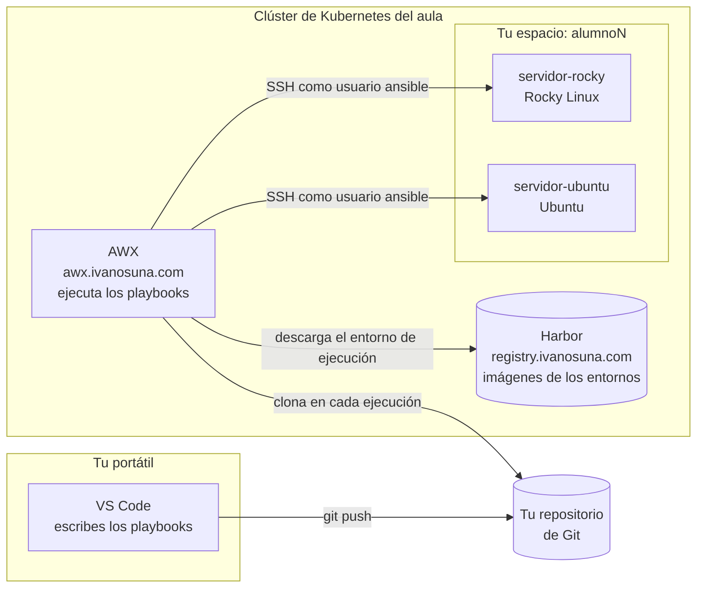

# DO374 — Automatización avanzada con Red Hat Ansible Automation Platform

## Bienvenida

Hola, bienvenido o bienvenida al curso. Soy Iván Osuna y voy a ser tu formador
esta semana.

Este curso parte de donde termina el de Ansible básico: ya sabes escribir
*playbooks*, usar variables, bucles y condicionales, y reutilizar roles.
Aquí vamos a trabajar como se hace en un equipo de verdad: entornos de
ejecución, colecciones propias, AWX, inventarios avanzados, transformación de
datos y actualizaciones sin parada del servicio.

En este repositorio tienes todo lo del curso: el temario, el *playbook* del
que partimos, las notas de cada día y, sobre todo, **cómo es y cómo se usa el
laboratorio**. Léelo con calma antes de empezar o durante la primera mañana.

| Dato           | Valor                                         |
|----------------|-----------------------------------------------|
| Fechas         | Del lunes 26 al viernes 30 de octubre de 2026 |
| Horario        | De 9:00 a 14:00                               |
| Temario        | [notas/temario.md](notas/temario.md)          |
| Notas de clase | [notas/](notas/), un fichero por día          |

**No tienes que instalar Ansible en tu portátil.** El laboratorio está en un
clúster de Kubernetes y se usa desde el navegador. Tus máquinas sólo son
accesibles desde dentro del clúster, así que los *playbooks* se ejecutan siempre
desde AWX.

---

## Cómo es el laboratorio

### Lo que tienes montado

Cada alumno tiene su propio espacio, separado del de los demás.

| Qué                     | Lo tuyo                                                              |
|-------------------------|----------------------------------------------------------------------|
| Usuario                 | `alumnoN`. Búscate en la tabla de abajo                              |
| Dos máquinas Linux      | `servidor-rocky` y `servidor-ubuntu`                                 |
| Un sitio donde ejecutar | Tu organización en AWX, con tu inventario y tu credencial ya puestos |

### Tu usuario

| Usuario    | Alumno            |
|------------|-------------------|
| `alumno1`  |                   |

### Arquitectura



Las piezas, una a una:

- **AWX** ejecuta tus *playbooks*. Es el proyecto de código abierto del que sale
  el *automation controller* de Red Hat Ansible Automation Platform, así que lo
  que aprendas aquí te vale allí. Cada vez que lanzas un trabajo, AWX vuelve a
  clonar el repositorio, de modo que siempre ejecuta lo último que hayas subido.
- **Harbor** guarda las imágenes de los entornos de ejecución: el contenedor
  con Ansible, las colecciones y los roles en el que AWX ejecuta cada *playbook*.
  Descargar de él no pide cuenta.
- **Tus dos máquinas** son contenedores que se comportan como servidores: tienen
  SSH, Python y un usuario `ansible` que puede hacer `sudo` sin contraseña. Es lo
  que Ansible necesita para trabajar. AWX entra en ellas por SSH con **tu propia
  clave**, que no es la de ningún compañero.

### Por qué está montado así

**Las máquinas se llaman igual para todos, y es a propósito.** Un *playbook*
escrito contra `servidor-rocky` funciona en el entorno de cualquiera sin cambiar
nada. Lo que cambia por debajo es la máquina a la que apunta ese nombre:

```
servidor-rocky   ->   servidor-rocky.alumnoN.svc.cluster.local
```

En el inventario, el alias (`servidor-rocky`) es igual para todos, y la variable
`ansible_host` apunta a tu *namespace*. Así podemos compartir código en clase sin
que nadie tenga que adaptarlo.

**Son Rocky Linux y Ubuntu a propósito.** Rocky es compatible con Red Hat
Enterprise Linux, y Ubuntu es de la familia Debian. Un *playbook* que funciona
en las dos es un *playbook* que ha resuelto de verdad las diferencias entre
distribuciones.

**Son contenedores, no máquinas virtuales.** Tienen una diferencia que vas a
notar: **no hay systemd**. El proceso principal es `sshd`, así que no se puede
arrancar un servicio con `systemctl` ni reiniciar la máquina. El *playbook* del
curso lo resuelve hablando directamente con los procesos, y lo explica en sus
comentarios.

**Tu espacio está aislado de la red.** Tus máquinas pueden salir a Internet a
descargar paquetes y AWX puede llegar a ellas, pero no pueden llegar al resto
del clúster. Rompe lo que quieras: no afecta a nadie más.

---

## Dónde se entra

Todo se hace desde AWX: **https://awx.ivanosuna.com**

Entras con tu usuario `alumnoN`. La contraseña te la digo en clase el primer día. No está escrita en
ningún sitio de este repositorio y no tienes que cambiarla.

Si se te olvida, pídemela. No la busques en el material.

---

## Qué hay en cada carpeta

```
proyectos/
  servidor web/             el playbook del que partimos

notas/
  temario.md                el temario del curso
  dia1.md ... dia5.md       los apuntes de clase, día a día
```

### `proyectos/servidor web/`

Un *playbook* que deja un servidor web funcionando en Rocky y en Ubuntu, y lo
comprueba: instala nginx en la versión que se le pida, configura el sitio,
despliega la web desde un repositorio de Git y prueba que responde, desde la
propia máquina y desde fuera.

Es **el punto de partida de la semana**. No vamos a escribir otro desde cero:
lo vamos a ir mejorando con lo que trae cada tema del curso.

Lo que tiene dentro:

- **`playbook.yaml`** y sus carpetas de tareas: `pre_tasks/` comprueba y
  prepara, `tasks/` instala, configura y despliega, y `post_tasks/` prueba.
- **`defaults/argumentos.yaml`**: los datos que acepta el *playbook* y sus
  valores por defecto, con ejemplos.
- **`execution-environment.yml`** y **`requirements.yml`**: el entorno de
  ejecución. La imagen en la que AWX ejecuta el *playbook*, con la versión de
  Ansible, las colecciones y el role `instalacion_paquetes` que necesita.
- **`IMAGEN.md`**: cómo se construye esa imagen y cómo se sube a Harbor.

**El entorno de ejecución también es código.** Se versiona y se vuelve a
construir cuando cambia. No es un detalle de la instalación.

---

## Cómo se trabaja

El circuito del curso es éste, y es el mismo que usarías en una empresa:

```
escribes en tu portátil  ->  subes a tu repositorio de Git  ->  AWX lo ejecuta
```

1. **Escribes** tus *playbooks* en el editor que prefieras: VS Code, vim o
   cualquier otro.
2. **Los subes** a tu repositorio de Git.
3. **AWX los ejecuta** contra tus máquinas. Allí tienes tu propia organización,
   con tu inventario (`alumnoN-laboratorio`) y tus dos máquinas ya dadas de alta
   en el grupo `servidores`.

No tienes que configurar el inventario: ya está puesto y apunta a tus máquinas.

### Lo que necesitas en tu portátil

Poca cosa, y seguramente ya lo tienes:

- **Un editor de texto.** VS Code va bien, con la extensión de Ansible de Red
  Hat. Cualquier otro editor también sirve.
- **Git**, para subir tu trabajo.
- **Un navegador.**

No hace falta instalar Ansible.

### Si quieres validar en tu portátil (opcional)

Desde tu portátil no puedes llegar a las máquinas, así que ahí no se ejecuta
nada. Sí puedes comprobar que un *playbook* está bien escrito antes de subirlo,
y te ahorras ir y volver a AWX por una errata. Necesitas:

- **Podman o Docker**, para el entorno de ejecución.
- **`ansible-navigator`**: `pip install ansible-navigator`.

```bash
cd "proyectos/servidor web"
ansible-navigator run playbook.yaml --syntax-check --mode stdout \
  --eei registry.ivanosuna.com/curso/ee-servidor-web:v1.2.0
```

Si no da errores, el *playbook* está bien escrito. Que además haga lo que tiene
que hacer sólo lo vas a saber ejecutándolo en AWX.

---

## La primera comprobación

Antes de escribir nada, entra en AWX y lanza la plantilla
`alumnoN-comprobar-laboratorio`, que ejecuta el *playbook* de prueba. Si sale
bien, el laboratorio está completo y puedes empezar.

Te tiene que decir qué sistema operativo tiene cada máquina. Si eso funciona,
funciona todo lo demás: la conexión, las credenciales, los permisos y la red.

**Si falla, no pierdas tiempo peleándote con ello.** Avísame y lo miramos. El
primer día es cuando salen los problemas del laboratorio, y lo más probable es
que sea cosa del laboratorio y no tuya.

---

## Cosas que te van a pasar, y por qué

**«No conecta con la máquina».** Si AWX da `UNREACHABLE` o
`Permission denied`, no toques nada de tu lado: la credencial SSH ya está
configurada en AWX y el fallo es del laboratorio. Avísame.

**«A mí me funciona y a mi compañero no».** Cada uno tiene sus propias máquinas.
Si le pasas un *playbook* a alguien, le funcionará, porque los nombres son los
mismos. Si le pasas tu *inventario*, no le funcionará, porque ése sí apunta a
tus máquinas.

**«El trabajo sale en verde pero no ha hecho nada».** Mira si pone
`skipping: no hosts matched`. Significa que el `hosts:` de tu *playbook* no
coincide con ningún equipo ni grupo del inventario. Ansible no lo considera un
error, pero no se ha conectado a nada.

**«He cambiado algo y AWX sigue haciendo lo de antes».** Si el cambio es del
*playbook*, mira que lo hayas subido a Git. Si es del entorno de ejecución, AWX
sólo usa la imagen nueva si tiene **otra etiqueta**: subir una imagen distinta
con la misma etiqueta no cambia nada si AWX ya tenía la vieja.

**«He roto mi máquina».** No pasa nada, para eso está. Avísame y la
reconstruimos en un minuto. Es un laboratorio, no un servidor de producción:
rómpelo, que así es como se aprende.

**«Se me ha borrado lo que tenía».** Lo que esté en tu repositorio de Git
sobrevive a todo. Lo que esté sólo dentro de una máquina, no. Sube tu trabajo.

---

## Al terminar el curso

El laboratorio se desmonta y las máquinas desaparecen. **Tu repositorio de Git es
tuyo y te lo quedas**, con todo lo que hayas escrito.

Sube lo que quieras conservar antes del último día.
